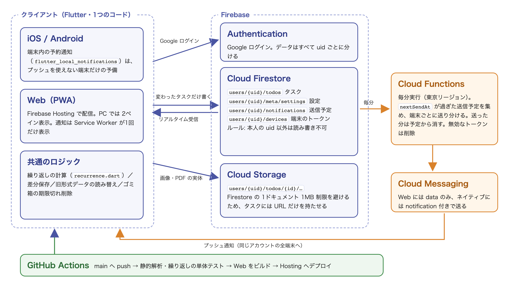

# TODO アプリ（Flutter）

期限通知・繰り返し・タグ・画像/PDF添付・ゴミ箱・バックアップを備えた、個人開発のタスク管理アプリです。Flutter の1つのコードから iOS・Android・Web（PWA）を作り、Firebase で**端末間のリアルタイム同期**と**端末をまたいだプッシュ通知**を実現しています。運用費は **0円**（Firebase の無料プラン Spark と Cloudflare Workers の無料プランだけで動かし、クレジットカードの登録も不要）です。

> 個人開発。企画・設計・実装・Firebase の構築・自動デプロイまでを一人で担当しました。
> 作品説明資料と動作紹介動画は [docs/portfolio/](docs/portfolio/) にあります（[PORTFOLIO.md](docs/portfolio/PORTFOLIO.md) ／ [todo-demo.mp4](docs/portfolio/todo-demo.mp4)）。

<p align="center">
  
</p>

---

## 目次

- [主な機能](#主な機能)
- [画面構成](#画面構成)
- [技術スタック](#技術スタック)
- [アーキテクチャ](#アーキテクチャ)
- [ディレクトリ構成](#ディレクトリ構成)
- [データモデル](#データモデル)
- [設計上の工夫](#設計上の工夫)
- [セットアップ・実行方法](#セットアップ実行方法)
- [デプロイ](#デプロイ)

---

## 主な機能

### タスク管理

- **追加・編集・複製・削除**（タイトル / 概要 / リンク / タグ / 期限 / 繰り返し / 通知 / 画像 / PDF）
  - 複製は画像・PDF の実体も読み込み直して複製側へ入れ直すため、元のタスクを消しても複製側の添付は壊れない
- **5つのタブ**
  - やること … 通常のタスク
  - 今日やること … 期限が今日まで（期限切れを含む）のタスクを自動で抽出
  - 明日やること … 期限が明日のタスクを自動で抽出
  - 完了済み … 完了したタスク
  - やりたいこと … 期限の無い目標を★の優先度（高 / 中 / 低 / なし）つきで管理
- 「やること」⇄「やりたいこと」の移動、完了 / 未完了の切り替え（完了日時を記録）、期限切れの強調表示
- **検索**: タイトル・概要・タグ・リンクが対象。一致が無いタブでは、ほかのタブの件数を案内する
- **ゴミ箱**: 削除はゴミ箱への移動。直後のスナックバーの「元に戻す」で戻せ、設定 → データ管理 → ゴミ箱 から復元・完全削除ができる。7日を過ぎたものは起動時に添付ごと自動で完全削除

### 期限・通知

- 日付＋時刻で期限を設定
- 通知は **期限の時間 / 10分前 / 1時間前 / 1日前 / 任意の分数** から、タスクごとに複数設定可。既定の通知タイミングとプリセットは設定で変更できる
- **プッシュ通知（FCM）で端末をまたいで届く**。PC で設定した通知が、アプリを開いていない iPhone / Android にも届く
  - 送信予定は Firestore に保存し、毎分実行の Cloud Function がアカウントの全端末へ送る
  - プッシュを使えない端末は、端末内の予約通知（`flutter_local_notifications`）に自動で切り替わり、二重には鳴らない
  - Web（iPhone のホーム画面アプリを含む）は、設定画面の「この端末で通知を受け取る」から通知を許可する

### 繰り返し

- プリセット（毎日 / 毎週○曜日 / 平日 / 毎月n日 / 毎月第n○曜日 / 毎年）は期限の日付から具体化される
- カスタム設定で「間隔（n日・n週・nか月・n年ごと）」「曜日の複数指定」「月内の位置（日付 / 第n○曜日 / 最終○曜日）」「終了条件（終了日 / 回数）」を組み合わせられる
- 完了時に「次回に進める」か「繰り返しを終了して完了」を選べる。終了条件に達すると完了扱いになる

### タグ

- 「やること」系と「やりたいこと」でタグを別々に管理
- タグで絞り込み。設定画面と絞り込み行のドラッグで並び替え

### 画像・PDF・リンクの添付

- 画像: カメラ / ギャラリー / 貼り付け（Ctrl/Cmd+V・ペーストボタン）で複数添付。HEIC は JPEG に変換
- PDF: 複数添付（1件20MBまで）
- 実体は Cloudflare Workers KV（[worker/](worker/) の Worker が出し入れする）に置き、タスクには URL とファイル名だけを保存する
- iOS / Android はディスクキャッシュでオフラインでも表示できる

### 同期・アカウント

- Google アカウントでログインし、タスクと設定（タグ・配色・通知の既定値など）を端末間でリアルタイムに同期
- 同期を入れる前に端末内へ保存していたデータは、初回ログイン時に一度だけクラウドへ移行

### バックアップ（エクスポート / インポート）

- 全タスク / 完了済みタスクを **ZIP（人が読める .txt ＋ 復元用 .json）** で書き出し、共有シートから保存
- JSON / ZIP から復元（**ID の重複を検出して二重登録を防止**、未登録のタグも取り込み）

### 設定・その他

- アプリ名の変更、カラーテーマ（9色）、画面の明るさ（端末に合わせる / ライト / ダーク）
- 削除確認ダイアログ・スワイプ削除の ON/OFF、並び順（期限の昇順 / 降順）
- 開発者への問い合わせ（画像添付可）

---

## 画面構成

| 画面 | 役割 |
|------|------|
| ログイン | Google アカウントでログイン |
| ホーム（タブ） | カテゴリ別のタスク一覧。画面幅 1000px 以上では **2ペイン**（左: 一覧、右: 詳細の編集）。左のスクロールに右の詳細が追従する |
| タスク追加 / 編集ダイアログ | スマートフォン幅での入力画面 |
| 繰り返しのカスタム設定 | 間隔・曜日・月内の位置・終了条件を選ぶボトムシート |
| 設定 | アプリ名・タグ・動作・通知・並び順・配色・バックアップ・データ管理・アカウント |
| ゴミ箱 | 削除したタスクの復元・完全削除 |
| 問い合わせ | 開発者への問い合わせの送信 |

---

## 技術スタック

| 分類 | 使用技術 |
|------|----------|
| フレームワーク | Flutter 3.47（Dart SDK ^3.11）。iOS / Android / Web |
| 認証 | `firebase_auth`（Google ログイン） |
| データ | `cloud_firestore`（リアルタイム同期） |
| ファイル | `http`（添付の置き場の Worker とのやり取り） / `cached_network_image`（iOS・Android のみ） / `flutter_image_compress`（HEIC → JPEG） / Web は heic2any |
| 通知 | `firebase_messaging`（プッシュ） / `flutter_local_notifications` ＋ `timezone`（予備の端末内通知） |
| サーバー処理 | Cloudflare Workers（Free プラン。Cron Triggers で毎分実行し、Firestore の REST API と FCM HTTP v1 API を呼ぶ） / Workers KV（添付の実体） |
| 端末内の保存 | `shared_preferences`（移行済みフラグ・端末ID・レイアウト幅など） |
| 入力・共有 | `image_picker` / `file_picker` / `pasteboard` / `share_plus` / `url_launcher` |
| 圧縮 | `archive`（ZIP の生成・展開） |
| 国際化 | `flutter_localizations` / `intl` |
| 配信・CI | Firebase Hosting（Web 版） / GitHub Actions |

---

## アーキテクチャ

<p align="center">
  
</p>

> 図は Cloud Functions・Cloud Storage を使っていた移行前の構成です。2026年10月に、通知の送信と添付の置き場を Cloudflare Workers に移しました（理由は [TECHNICAL.md](docs/portfolio/TECHNICAL.md) の 4.7）。

- データはすべて `users/{uid}/…` の下に置き、Firestore のルールで本人以外の読み書きを禁止
- 保存時は中身が変わったタスクだけを書き込む（変更が無ければ通信しない）
- 通知の送信予定をタスクごとに `users/{uid}/notifications` へ書き、Cloudflare Workers の Worker が毎分、時刻の来た分を全端末へ送る。Web へは data のみ（Service Worker が1回だけ表示）、ネイティブへは notification 付きで送り分ける
- 画像・PDF は同じ Worker が Workers KV に預かる。アップロードと削除は Firebase の ID トークンで本人を確かめ、読み出しは推測できない ID を含む URL で行う

---

## ディレクトリ構成

機能ごとにファイルを分け、Dart の `part` / `part of` で `main.dart` を起点に1つのライブラリにまとめています（`lib/` 83ファイル・約10,700行）。

```text
todo_app/
├── lib/
│   ├── main.dart                   # 起動・Firebase 初期化・part の集約
│   ├── app/                        # MaterialApp・テーマ / ログイン状態での切り替え
│   ├── app_settings.dart           # 設定モデル（端末内とクラウドの両方へ保存）
│   ├── notification_service.dart   # プッシュの登録と端末内の予約通知
│   ├── attachment_store.dart       # 添付の置き場（Worker）とのやり取り・旧 Storage の URL の読み替え
│   ├── models/
│   │   ├── todo_item.dart          # タスクのデータモデル（旧形式の読み替えを含む）
│   │   └── recurrence.dart         # 繰り返しの設定と次回の計算
│   ├── pages/
│   │   ├── sign_in/                # ログイン画面
│   │   └── todo_home/
│   │       ├── core/               # 画面本体・同期と差分保存・2ペイン・クエリ
│   │       ├── actions/            # 追加/削除/複製/移動/書き出し/復元
│   │       ├── dialogs/            # 各種ダイアログ・ゴミ箱・問い合わせ
│   │       ├── form_fields/        # 日付・時刻・通知・繰り返し・添付などの入力部品
│   │       ├── list/               # 一覧・カード・検索・タグの絞り込み
│   │       └── media/              # 画像・PDF の添付と置き場への送信
│   └── settings/                   # 設定画面（セクション/アクション/部品）
├── functions/                      # 移行前の通知の Cloud Function（Worker へ切り替えたら削除する）
├── firestore.rules                 # Firestore のセキュリティルール
├── web/firebase-messaging-sw.js    # Web のプッシュ通知を表示する Service Worker
├── test/recurrence_test.dart       # 繰り返しの単体テスト（40件）
└── test/attachment_store_test.dart # 添付の置き場とのやり取りの単体テスト（12件）

worker/                             # Cloudflare Worker（通知の送信と添付の置き場）
├── wrangler.toml                   # 毎分の Cron Trigger・KV・変数（鍵やアカウント ID は書かない）
├── src/notify.js                   # 毎分の送信処理（Cloud Function の sendDueNotifications を移したもの）
├── src/schedule.js                 # 送信予定のうち、何を送り何を残すか（planDelivery）
├── src/files.js                    # 添付のアップロード・読み出し・削除
├── src/google-auth.js / firestore.js / fcm.js / id-token.js  # Google の API と ID トークンの検証
├── scripts/legacy-to-kv.mjs        # 旧 Storage の添付を KV へ移すスクリプト
└── test/                           # node:test の単体テスト（35件、依存なし）
```

---

## データモデル

タスク（`TodoItem`、Firestore の `users/{uid}/todos/{id}`）の主なフィールド：

| フィールド | 型 | 説明 |
|------------|----|----|
| `id` | int | 一意な ID（作成時刻から生成） |
| `title` | String | タイトル |
| `description` | String? | 概要・メモ |
| `links` | List\<String\> | 添付リンク |
| `isDone` | bool | 完了フラグ |
| `category` | String | `todo` / `done` / `future` |
| `taskTag` | String? | タグ |
| `dueDate` | DateTime? | 期限（日付＋時刻） |
| `recurrence` | Map? | 繰り返し設定（単位・間隔・曜日・月内の位置・終了条件・進捗）。null は繰り返しなし |
| `imageBase64List` | List\<String\> | 添付画像（置き場の URL。アップロード前は Base64） |
| `attachments` | List\<Map\> | 添付 PDF（`url` と `name`） |
| `priority` | enum | なし / 低 / 中 / 高 |
| `completedAt` | DateTime? | 完了日時 |
| `deletedAt` | DateTime? | ゴミ箱に入れた日時（null は通常のタスク） |
| `notificationOffsets` | List\<int\>? | 通知タイミング（期限までの分数）。null は既定値に従う、空は通知しない |

そのほか、`users/{uid}/meta/settings`（設定）、`users/{uid}/notifications`（通知の送信予定）、`users/{uid}/devices`（端末のトークン）を使います。

---

## 設計上の工夫

- **繰り返しの暦のずれを防ぐ**: 曜日・日を省略した設定は最初の完了時に期限から基準を確定し、月末や第5週で丸めた後もずれ続けないようにしている。隔週は期限の週の月曜日を起点に位相を保つ。境界（うるう年・毎月31日・第5月曜日など）は単体テストで固定
- **後方互換性のあるデータ読み込み**: 旧フォーマット（`imageBase64` 単体・`taskCategory`・旧形式の繰り返し `recurrenceRule` など）も読み込み時に新形式へ変換し、アプリを更新してもデータが壊れない
- **通知の重複を作りから防ぐ**: 表示経路を端末の種類ごとに1つに決め、端末ごとの固定IDで古いトークンの登録を消す。無効なトークンは関数側で削除
- **添付の整合性**: Firestore の1ドキュメント1MB制限を避けて実体は置き場（Workers KV）に置き、削除・編集で外した添付は置き場からも消す。アップロードできなかった添付は端末に持ったまま再送し、送り終えるまでタスクを Firestore に書かない
- **0円で動かす**: Firebase は Spark プラン、通知の送信と添付は Cloudflare Workers の無料プラン。無料枠（外部への fetch は1回50回まで、CPU 時間 10ms など）に合わせて、Google のアクセストークンを1時間使い回し、1回の実行で送り切れない分は次の分に回す
- **UI の堅牢性**: OS の文字サイズ設定が極端でも崩れないよう拡大率に上限・下限を設定。キーボード表示中もダイアログの入力欄と保存ボタンに届くようにしている
- **エラーハンドリング**: ファイル選択・読み込み・共有・アップロードの失敗はスナックバーで伝え、アプリを落とさない

---

## セットアップ・実行方法

### 前提

- Flutter 3.47.1（CI と同じ版）
- 実機、または iOS シミュレータ / Android エミュレータ / Chrome

### 依存パッケージの取得と実行

```bash
cd todo_app
flutter pub get
flutter run                 # 接続中の端末を選ぶ（Web は flutter run -d chrome）
```

アプリはログインと保存に Firebase（`lib/firebase_options.dart` のプロジェクト）を使います。

### テスト・静的解析

```bash
cd todo_app
flutter test test/recurrence_test.dart test/attachment_store_test.dart   # Firebase・通信は不要
flutter analyze

cd ../worker
node --test test/*.test.js   # Worker の単体テスト（依存なし。Google・Cloudflare にはつながない）
```

### iPhone 実機へのリリースビルド

```bash
cd todo_app
flutter devices
flutter run -d <デバイスID> --release
```

---

## デプロイ

- **Web 版**: `main` へ push すると GitHub Actions（[.github/workflows/deploy-web.yml](.github/workflows/deploy-web.yml)）が静的解析・単体テスト・ビルドを行い、Firebase Hosting へデプロイします（シークレット `FIREBASE_SERVICE_ACCOUNT` が必要）
- **Firestore のルール**: `cd todo_app && firebase deploy --only firestore:rules`（Spark プランでもデプロイできる）
- **Worker（通知の送信と添付の置き場）**: Cloudflare のアカウント（無料・カード不要）で、[worker/](worker/) から公開します。鍵やアカウント ID はリポジトリに入れません。

```bash
cd worker
npm install                 # wrangler を入れる
npx wrangler login          # ブラウザで Cloudflare にログイン
npx wrangler secret put GOOGLE_SERVICE_ACCOUNT < ~/Downloads/<サービスアカウントの鍵>.json
npx wrangler deploy         # 初回は KV が作られ、wrangler.toml に id が書き戻される
```

  公開すると `https://todo-app-worker.<アカウントのサブドメイン>.workers.dev` になります。この URL を [`attachment_store.dart`](todo_app/lib/attachment_store.dart) の `kDefaultAttachmentApiBase` に書いてアプリを出し直してください（空のままだと画像・PDF を付けたタスクが保存されないので、CI は空のままの Web 版をデプロイしない）。URL はあとから変えないでください（変えると、それまでの添付を消せなくなる）。
  サービスアカウントには **Cloud Datastore ユーザー**（`roles/datastore.user`）と **Firebase Cloud Messaging API 管理者**（`roles/firebasecloudmessaging.admin`）の2つだけを付けます。

- **費用について**: すべて無料枠で動きます（0円）。

| サービス | 使い方 | 無料枠のうち、効いてくるもの |
|---|---|---|
| Firebase（Spark） | Authentication・Firestore・Hosting・Cloud Messaging | Firestore は 1GiB・読み取り5万/日・書き込み2万/日・削除2万/日、Hosting は 10GB・転送 360MB/日、FCM は無料 |
| Cloudflare Workers Free | 毎分の Cron Trigger と添付の口 | リクエスト10万/日、1回の CPU 時間 10ms、外部への fetch は1回50回まで、Cron Trigger は5個まで |
| Workers KV（Free） | 添付の実体・Google のアクセストークンの控え | 容量 1GB、読み取り10万/日、書き込み・削除・一覧 各1,000回/日、1件 25MiB まで |

  添付のアップロードは1件につき KV の書き込み1回なので、**全利用者の合計で1日1,000件まで**です。無料枠を超えたときは課金されず、その日の操作が失敗するだけです（アプリは送れなかった添付を端末に持ったまま、あとで送り直します）。

- **移行前の Cloud Functions について**: 以前は Cloud Functions（`todo_app/functions/`）が Cloud Scheduler から毎分呼ばれて通知を送り、添付は Cloud Storage に置いていました。どちらも課金が有効な請求先アカウント（Blaze プラン）が必要で、2026年10月に無料トライアルの請求先アカウントが閉じて止まりました（経緯は [TECHNICAL.md](docs/portfolio/TECHNICAL.md) の 4.7）。Worker へ切り替えたあと、`functions/` と `firebase.json` の `functions` は削除します。
