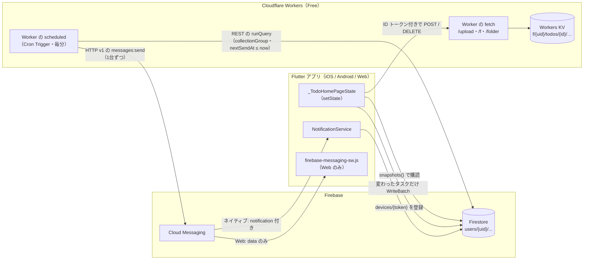
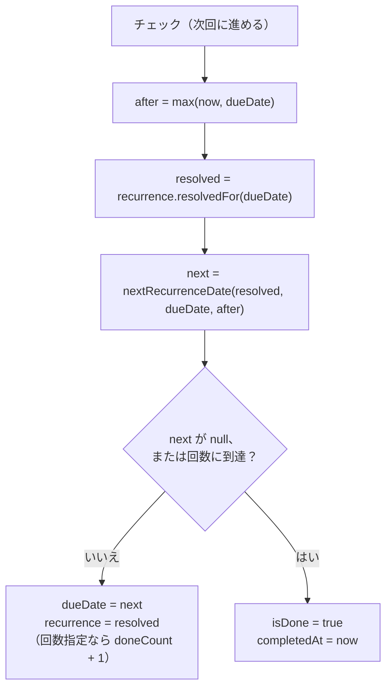
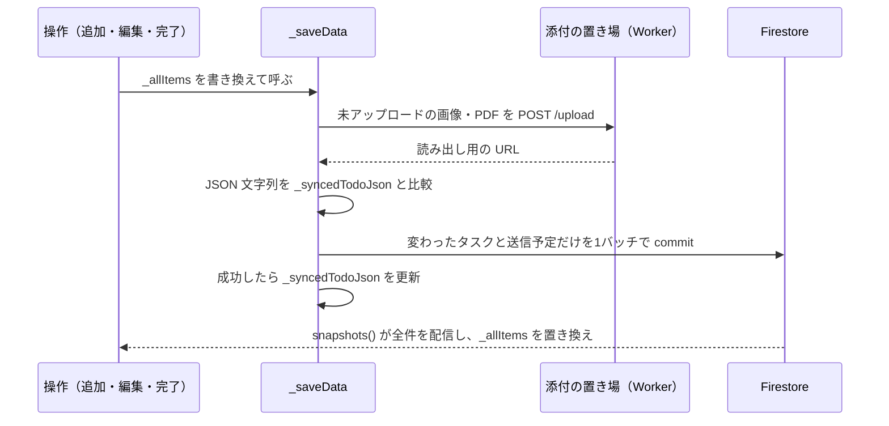
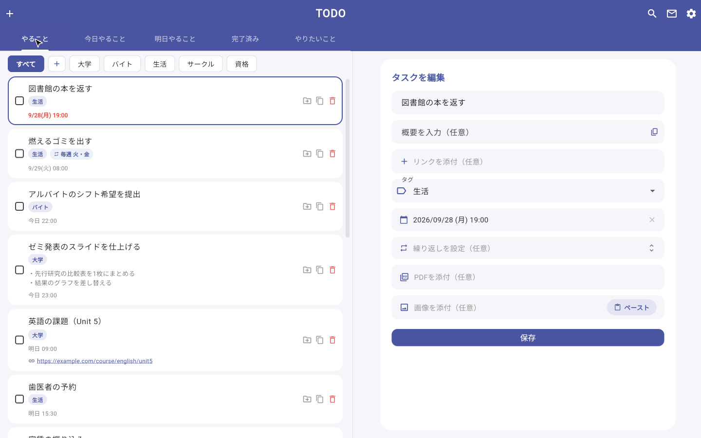

<h1 align="center">TODO アプリ — 実装詳細</h1>

本資料は、TODO アプリ（Flutter / Firebase）が**どう作られているか**を、構成・データ構造・繰り返しの計算・通知・同期・2ペインの追従の順に、実際のコードを引きながら説明する。作った目的、機能の全体像、工夫の要点と結果は[作品説明資料](https://github.com/mocaluna0117/TODO_APP_ver3/blob/main/docs/portfolio/PORTFOLIO.md)にまとめてある。本資料はそれを前提に、一段下の「どの関数が、何を、どう計算しているか」を扱う。コードへのリンクはすべて `main` ブランチのファイルを指す。

## 1. 全体の構成

### 1.1 1つのライブラリを part で分割する

アプリ本体は [`main.dart`][main] を起点にした**1つの Dart ライブラリ**で、機能ごとのファイルは `part` / `part of` でつながっている。ホーム画面の状態はすべて `_TodoHomePageState` が持ち、各ファイルはその State に対する **private な extension** として書かれている（`_TodoHomePageState` に対する extension は43個）。

```dart
// lib/main.dart
part 'pages/todo_home/core/todo_home_data.dart';

// lib/pages/todo_home/core/todo_home_data.dart
part of '../../../main.dart';

extension _TodoHomeData on _TodoHomePageState {
  CollectionReference<Map<String, dynamic>> _todosCollection() { ... }
```

同じライブラリなので、各ファイルは State の private なフィールド（`_allItems` など）を直接読み書きできる。`setState` は `@protected` のため、extension からは State 側に置いた1行のラッパーを経由して呼ぶ（[`todo_home_page.dart`][home_page]）。

```dart
void _updateState(VoidCallback fn) => setState(fn);
```

設定画面だけは別ライブラリ（[`settings_page.dart`][settings_page]）で、`main.dart` を import しない。書き出し・復元・ゴミ箱・通知の有効化などは、ホーム側が `onExportTasks` / `onImportTasks` / `onOpenTrash` / `onEnablePushNotifications` などの**コールバックとして渡す**（[`_openSettings`][home_settings]）。

### 1.2 状態管理と画面遷移

状態管理のパッケージ（Provider、Riverpod など）やルーティングのパッケージは使っておらず（[`pubspec.yaml`][pubspec]）、`StatefulWidget` と `setState` だけで組んでいる。

| 状態 | 持ち主 | 更新のしかた |
|---|---|---|
| 設定 `AppSettings` | `_MyAppState` が1つ作り、参照を下へ渡す | フィールドを直接書き換え、`onSettingsChanged` で `MyApp` を再ビルドしてテーマに反映 |
| タスク一覧 `_allItems` | `_TodoHomePageState` | Firestore の購読で丸ごと置き換える。操作時は要素を書き換えて `_saveData()` |
| 2ペインの選択と下書き | `_TodoHomePageState`（`_selectedDetailItemIds`、`_detailDraft`） | 選択はタブごとに覚える |
| 通知 | `NotificationService`（factory コンストラクタのシングルトン） | プッシュのトークンを `_pushToken` に持つ |

- **ログインの有無**: [`AuthGate`][auth_gate] が `authStateChanges()` を `StreamBuilder` で購読し、`SignInPage` と `TodoHomePage` を出し分ける。ストリームは State のフィールドとして一度だけ作る（build の中で作ると再購読でちらつくため、とコメントにある）
- **ログイン方法**: Web は `signInWithPopup`、ネイティブは `signInWithProvider` に `GoogleAuthProvider` を渡す（[`sign_in_page.dart`][sign_in]）
- **設定・ゴミ箱**: `Navigator.push` と `MaterialPageRoute`
- **追加・編集**: 画面幅が `kTwoPaneBreakpoint`（1000）未満ならダイアログ、以上なら右の詳細ペインに常設のフォームを出す
- **問い合わせ**: ダイアログではなく `OverlayEntry` で出し、開いたまま裏の一覧をスクロールできるようにしている

### 1.3 Firebase の使い分け

| サービス | 使い方 | 主なコード |
|---|---|---|
| Authentication | Google ログイン | [`sign_in_page.dart`][sign_in] |
| Cloud Firestore | タスク・設定・通知の送信予定・端末トークン。`snapshots()` で購読 | [`todo_home_data.dart`][data] |
| （Cloudflare Workers KV） | 画像・PDF の実体。Firebase の外に置く（5.3） | [`attachment_store.dart`][attachment_store]、[`worker/src/files.js`][worker_files] |
| Cloud Messaging | Web・iOS・Android へのプッシュ | [`notification_service.dart`][notif]、[`firebase-messaging-sw.js`][sw] |
| （Cloudflare Workers） | 毎分、時刻が来た通知を送る（Cron Trigger）。Firestore と FCM は REST で呼ぶ | [`worker/src/notify.js`][worker_notify] |
| Hosting | Web 版。全パスを `/index.html` へ書き換え、`Cache-Control: no-cache` | [`firebase.json`][firebase_json] |

Firebase のプロジェクトは無料の Spark プランで使う。Spark では Cloud Functions も Cloud Storage も使えないため、毎分の送信と添付の置き場は Cloudflare Workers の無料プランに置いている（2026年10月に移した。経緯は 4.7）。



### 1.4 Firestore のドキュメント構成とルール

```text
users/{uid}/
├── todos/{taskId}           … TodoItem.toJson() そのもの
├── notifications/{taskId}   … プッシュの送信予定（タスク1件に1ドキュメント）
├── meta/settings            … AppSettings.toMap()
└── devices/{token}          … { platform, installationId, updatedAt }
```

[`firestore.rules`][rules] は `users/{userId}` 以下を本人だけに開く1つのルールで、利用者ごとのデータを分けている。

```text
match /users/{userId}/{document=**} {
  allow read, write: if request.auth != null && request.auth.uid == userId;
}
```

Worker はサービスアカウントの権限（IAM）で Firestore の REST API を呼び、全利用者の `notifications` を横断して読む。ルールは利用者のアプリにだけ掛かるもので、Worker のためにルールを変える必要は無い。この collectionGroup クエリのために、`nextSendAt` の単一フィールドインデックスを COLLECTION_GROUP のスコープにも張っている（[`firestore.indexes.json`][indexes]）。

## 2. データモデル

### 2.1 TodoItem

[`TodoItem`][todo_item] は可変のクラスで、`toJson()` の結果がそのまま `todos/{taskId}` のドキュメントになる。

| フィールド | Dart の型 | Firestore 上の形・補足 |
|---|---|---|
| `id` | `int` | 生成時は `millisecondsSinceEpoch & 0x7FFFFFFF`（31ビットに収める）。ドキュメント ID は `id.toString()` |
| `title` / `description` | `String` / `String?` | |
| `links` | `List<String>` | `normalizeLinkList` で前後の空白を除き、空と重複を除外（順序は保つ） |
| `isDone` / `completedAt` | `bool` / `DateTime?` | 日時は ISO 8601 の文字列（`Timestamp` ではない） |
| `category` | `String` | 「やること」は `todo`、「やりたいこと」は `future`。完了済みタブは `isDone`、今日・明日タブは `dueDate` から都度抽出する |
| `taskTag` | `String?` | 追加・編集・移動のとき、カテゴリ側のタグ一覧に無いタグは外す |
| `dueDate` | `DateTime?` | ISO 8601 の文字列 |
| `recurrence` | `Recurrence?` | Map または null（3章） |
| `imageBase64List` | `List<String>` | 要素は添付の置き場の URL か、アップロード前の Base64。`startsWith('http')` で見分ける |
| `attachments` | `List<TaskFile>` | PDF。`[{url, name}]` |
| `pendingFiles` | `List<PendingTaskFile>` | アップロード前の PDF のバイト列。**JSON には出さない** |
| `priority` | `TaskPriority` | enum 名 |
| `deletedAt` | `DateTime?` | null 以外ならゴミ箱 |
| `notificationOffsets` | `List<int>?` | 期限までの分数。null は全体の既定に従う、空は通知しない |

### 2.2 読み込み時の正規化

`TodoItem.fromJson` は古い版で保存したキーを新しい形へ読み替える。`toJson` は新しい形だけを書き、保存は `set`（置き換え）なので、一度保存し直したドキュメントからは旧キーが消える。

| 旧形式 | 新形式 | 関数 |
|---|---|---|
| `taskCategory` | `taskTag` | `normalizeTaskTag` |
| `link`（1つ） | `links` | `_linksFromJson` |
| `imageBase64` / `picture` | `imageBase64List` に追加 | `normalizeImageBase64List` |
| `recurrenceRule`（enum 名または番号） | `recurrence` | `recurrenceFromLegacyRule` |
| `notificationTimings`（enum 名の配列） | `notificationOffsets`（分数） | `normalizeNotificationOffsets` |
| 旧 Firebase Storage のダウンロード URL（画像・PDF） | Worker の URL（5.3） | `migrateLegacyAttachmentUrl` |

### 2.3 端末内に残すもの

タスク本体をアプリ自身が端末へ保存する処理は無い。Firestore の購読結果をメモリ上の `_allItems` に持ち、Firestore SDK のオフライン永続化の設定もコードでは変えていない（SDK の既定に従う）。`SharedPreferences` に置くのは次のものである。

| キー | 用途 |
|---|---|
| `appTitle`・`themeMode`・`primaryColor` など設定一式 | 起動直後の描画に使う設定の写し（`loadFromPrefs`）。ログイン後は `meta/settings` の内容で上書きされる |
| `firestore_migrated` / `settings_migrated` | 端末内データのクラウド移行が済んだか（5.5） |
| `todo_items` | 同期を入れる前の端末内データ。移行のときに読むだけ |
| `installationId` | 端末の固定 ID（4.4） |
| `listPaneWidth` | 2ペインの左ペインの幅 |

画像は iOS / Android では `cached_network_image` のディスクキャッシュで表示し、Web では `Image.network`（ブラウザの HTTP キャッシュ）で表示する（[`_buildImage`][media]）。

## 3. 繰り返しの計算

### 3.1 Recurrence の形

[`Recurrence`][recurrence] は不変のクラスで、「設定」と「進捗（`doneCount`）」を1つに持つ。曜日や日を null / 空にした項目は期限から補う。こうするとプリセット（「毎週○曜日」など）は期限を変えるとそれに追従する、とファイル冒頭のコメントにある。

| フィールド | 意味 | null / 空のとき |
|---|---|---|
| `freq` | `daily` / `weekly` / `monthly` / `yearly` | — |
| `interval` | n日・n週・nか月・n年の n。`fromJson` で 1〜999 に丸める | 1 |
| `weekdays` | 週単位の曜日の集合（1=月〜7=日） | 期限の曜日 |
| `monthlyMode` | `dayOfMonth` / `nthWeekday` | `dayOfMonth` |
| `monthDay` | 日付指定の日（1〜31） | 期限の日 |
| `weekOrdinal` | 第n週（1〜5、-1 は最終） | 期限から `(day - 1) ~/ 7 + 1` |
| `monthWeekday` | 曜日指定の曜日 | 期限の曜日 |
| `end` / `until` / `count` | 終わり方（`never` / `until` / `count`） | `never` |
| `doneCount` | 繰り返した回数（回数指定の判定に使う） | 0 |

### 3.2 完了したときの流れ

未完了の繰り返しタスクにチェックを入れると、[`_toggleItem`][task_actions] は完了にする代わりに期限を次の回へ進める。



```dart
final now = DateTime.now();
// 期限が過去でも「今より後」の回に進める
final after = now.isAfter(dueDate) ? now : dueDate;
...
final resolved = recurrence.resolvedFor(dueDate);
final nextDueDate = nextRecurrenceDate(resolved, dueDate, after);
// 回数指定は、今回の完了で上限に達したらそこで打ち切る
final total = resolved.count;
final isCountLimited =
    resolved.end == RecurrenceEnd.count && total != null;
final reachedCount = isCountLimited && resolved.doneCount + 1 >= total;
```

- **探索の起点 `after` は「期限」と「今」の遅い方**。期限より前に完了すれば期限の次の回へ、期限を過ぎてから完了すれば今より後の最初の回へ進む
- **保存するのは確定後の設定 `resolved`**。次回の計算に使った基準がそのまま残るので、次の完了も同じ基準から計算する（3.3）
- 回数指定は「今の期限を1回目」と数え、`doneCount + 1 >= count` で終える。`doneCount` を増やすのは回数指定のときだけである

カードのチェックはポップアップメニューになっていて、「次回に進める」には同じ計算（`_nextRecurringDueDateOf`）で求めた次の日時を添える。「繰り返しを終了して完了」を選ぶと、[`_finishRecurringTask`][task_actions] が `recurrence` を null にしてから完了にするので、未完了に戻しても繰り返しは再開しない。

### 3.3 resolvedFor — 基準を最初の完了で固定する

```dart
Recurrence resolvedFor(DateTime dueDate) {
  final isWeekly = freq == RecurrenceFreq.weekly;
  final isMonthly = freq == RecurrenceFreq.monthly;
  final byWeekday = isMonthly && monthlyMode == MonthlyMode.nthWeekday;
  final isLeapDay = dueDate.month == DateTime.february && dueDate.day == 29;
  final int? resolvedDay;
  if (isMonthly && !byWeekday) {
    resolvedDay = monthDay ?? dueDate.day;
  } else if (freq == RecurrenceFreq.yearly && isLeapDay) {
    resolvedDay = monthDay ?? 29;
  } else {
    resolvedDay = monthDay;
  }
  return Recurrence(
    ...
    weekdays: isWeekly && weekdays.isEmpty
        ? <int>{dueDate.weekday}
        : weekdays,
    monthDay: resolvedDay,
    weekOrdinal: byWeekday
        ? (weekOrdinal ?? recurrenceWeekdayOrdinal(dueDate))
        : weekOrdinal,
    monthWeekday: byWeekday ? (monthWeekday ?? dueDate.weekday) : monthWeekday,
    ...
```

null の項目を毎回「その時点の期限」から補うと、丸めた後の日付が次の基準になってしまう。たとえば `monthDay` が null の「毎月」で期限が1/31 なら、次回は2/28 になり、その次は `28` を基準に計算して3/28 になる。`resolvedFor` は最初の完了で `monthDay = 31` を書き込むので、以降は 2/28 → 3/31 → 4/30 と進む。このとおりの遷移と `monthDay == 31` をテストで固定している。

年単位で丸めが起きるのは 2/29 だけなので、年単位では **期限が 2/29 のときだけ** `monthDay = 29` を書き込む。2/28 へ丸めた後もこの 29 を目指して計算するので、うるう年に 2/29 へ戻る（3.4）。

関係の無い項目は埋めない（月単位なら `weekdays` は空のまま）。テストでは、旧形式から移行した「毎週」「毎月」「毎月第n曜日」を `resolvedFor` で確定すると、期限から作ったプリセットのどれかと `hasSameConfig` で一致することも確かめている。

### 3.4 単位ごとの次回の求め方

`nextRecurrenceDate(recurrence, dueDate, after)` は、`dueDate` を基準にして `after` より後の最初の発生日時を返す。どの単位でも、時刻（時・分・秒・ミリ秒・マイクロ秒）は期限のものを引き継ぐ。

**日単位**。期限が何年も前でも、1回ずつ足さずに必要な回数をまとめて足す。

```dart
var next = dueDate.add(Duration(days: interval));
if (!next.isAfter(after)) {
  final elapsedDays = after.difference(next).inDays;
  next = next.add(
    Duration(days: (elapsedDays ~/ interval + 1) * interval),
  );
}
while (!next.isAfter(after)) {
  next = next.add(Duration(days: interval));
}
```

足す量は常に `interval` の倍数なので、期限から数えた位相が保たれる。テストでは、2021-08-11 が期限の「3日ごと」を 2026-08-23 12:00 から進め、`next.difference(past).inDays % 3 == 0` を確かめている。

**週単位**。期限の週の月曜日 $W_0$ を起点に、昇順に並べた曜日 $w$ について

$$d(\mathrm{step}, w) = W_0 + 7 \cdot \mathrm{interval} \cdot \mathrm{step} + (w - 1)$$

を step = 0, 1, 2, … の順に作り、最初に `after` を超えた候補を返す。

```dart
final weekStart = DateTime(
  dueDate.year,
  dueDate.month,
  dueDate.day - (dueDate.weekday - 1),
);
for (var step = 0; step < _recurrenceSearchLimit; step++) {
  for (final weekday in weekdays) {
    final candidate = DateTime(
      weekStart.year,
      weekStart.month,
      weekStart.day + 7 * interval * step + (weekday - 1),
      dueDate.hour,
      ...
    );
    if (candidate.isAfter(after)) return candidate;
  }
}
```

起点は完了した日ではなく**期限の週**なので、「2週ごと 月・水」は完了が遅れても位相が崩れない。テストでは 2026-08-24（月）から 8/26 → 9/7 → 9/9 → 9/21 → 9/23 と進むことを固定している。日の足し算は `DateTime(年, 月, 日 + n)` の形で書き、月をまたぐ繰り上がりは `DateTime` に任せている。

**月単位**。期限の年月 $(y, m)$ から $\mathrm{interval} \times \mathrm{step}$ か月後の年月を

$$k = (m - 1) + \mathrm{interval}\cdot\mathrm{step},\qquad y' = y + \lfloor k / 12 \rfloor,\qquad m' = (k \bmod 12) + 1$$

で求め、その月の発生日を `_monthlyOccurrence` で決める。step = 0（期限と同じ月）も候補に入れるので、期限が 8/3 の「2か月ごと15日」は同じ月の 8/15 が次回になる（テストあり）。$D$ をその月の日数として、

- **日付指定**: $\min(\mathrm{monthDay}, D)$。「31日」は2月なら月末になる
- **第n曜日**: 1日の曜日を $w_1$ として $\mathrm{day} = 1 + (w - w_1 + 7) \bmod 7 + 7(n - 1)$。$D$ を超えたら7ずつ引く（第5週の無い月は、その月で最後の同じ曜日に丸める）
- **最終曜日**: 月末日の曜日を $w_L$ として $\mathrm{day} = D - (w_L - w + 7) \bmod 7$

**年単位**。$y + \mathrm{interval} \times \mathrm{step}$ 年の、期限と同じ月の日である。日は `_yearlyDay` が決める。2/29 を固定した設定（`monthDay == 29`）で期限が2月の末日（平年は28日、うるう年は29日）なら 29、それ以外は期限の日を使う。その年の2月に29日が無ければ 28 に丸める。

```dart
int _yearlyDay(Recurrence recurrence, DateTime dueDate) {
  final pinned = recurrence.monthDay;
  final isEndOfFebruary =
      dueDate.month == DateTime.february &&
      dueDate.day == DateUtils.getDaysInMonth(dueDate.year, DateTime.february);
  if (pinned != null && isEndOfFebruary) return pinned;
  return dueDate.day;
}
```

これで 2028/2/29 → 2029/2/28 → 2030/2/28 → 2031/2/28 → 2032/2/29 と進む。固定した日を使うのは期限が2月の末日のときだけなので、期限を別の日（2/10 や別の月）へ動かせばその日に従う。表示も同じ関数を使い、平年の 2/28 の期限でも「毎年2月29日」と出す。カスタム設定のシートで年単位のまま保存したときも、この固定は消さない。

### 3.5 600回の打ち切りと終了条件

週・月・年のループは `_recurrenceSearchLimit = 600` で止める。届く範囲は、週単位なら $600 \times \mathrm{interval}$ 週先（毎週なら約11年半）、月単位なら $600 \times \mathrm{interval}$ か月先（毎月なら50年）までである。日単位はまとめて足すので、この上限を使わない。見つからなければ `null` を返し、呼び出し側（3.2）は繰り返しの終了として扱う。

終了日は `nextRecurrenceDate` の最後で判定し、`next.isAfter(until)` なら `null` を返す。繰り返しのシート（[`todo_home_recurrence_sheet.dart`][recurrence_sheet]）は終了日を `DateTime(年, 月, 日, 23, 59)` として保存するので、終了日と同じ日の回はまだ繰り返す。シートで選べる間隔は30まで、回数は50までである。回数指定の進捗 `doneCount` は、シートで終了条件（種類または回数）を変えると0に戻す（`_keepsProgress`）。

### 3.6 壊れた値への備え

`Recurrence.fromJson` は、`freq` が無いか Map でなければ null（繰り返しなし）を返し、それ以外の範囲外の値は丸めるか捨てる。`interval` は 1〜999、`weekdays` は 1〜7 だけを残し、`monthDay` は 1〜31、`weekOrdinal` は 1〜5 か -1、`count` は1以上でなければ null にする。知らない enum 名は既定値になる。テストでは `{'interval': 0, 'weekdays': [0, 3, 99, 'x'], 'monthDay': 99, ...}` が `interval = 1`、`weekdays = {3}` になることを確かめている。

## 4. 通知

### 4.1 2つの経路と、二重に鳴らさない切り替え

| | プッシュ（FCM） | 端末内の予約 |
|---|---|---|
| 対象 | トークンを取れた端末（Web を含む） | プッシュを使えない iOS / Android |
| 予定の置き場所 | Firestore の `users/{uid}/notifications/{taskId}` | OS の予約（`flutter_local_notifications` の `zonedSchedule`） |
| 鳴らすもの | 毎分動く Worker（Cloudflare Workers の Cron Trigger） | OS |
| 他の端末で作ったタスク | そのまま届く | 同期の受信時に `rescheduleAll` で予約し直す |

どちらを使うかは [`NotificationService`][notif] の `usesPush`（トークンを取れたか）だけで決まる。送信予定は端末の種類にかかわらず Firestore に書く。

```dart
bool get usesPush => _pushToken != null;
...
// scheduleNotification
if (kIsWeb) return;
await init();
// プッシュが使える端末では、サーバーから送られる分だけを鳴らす
if (usesPush) return;
```

`rescheduleAll` は先に `cancelAll()` してから `usesPush` を見るので、プッシュを使える端末には端末内の予約が残らない。

### 4.2 送信予定のドキュメント

`_saveData` は、内容が変わったタスクについて、タスク本体と**同じバッチで**送信予定も作り直す（[`_addNotificationOps`][data]）。

```dart
batch.set(docRef, {
  'taskId': item.id,
  'title': '期限が近づいています',
  'entries': entries,
  // 次に送る時刻。関数はこれで対象を絞り込む。
  'nextSendAt': entries.first['sendAt'],
});
```

`entries` は `_pendingNotificationEntries` が作る `{sendAt, body}` の配列である。通知タイミング（期限までの分数）を降順に並べてから `sendAt = dueDate − 分数` を求めるので、**送信時刻の昇順**になり、先頭が `nextSendAt` になる。過ぎた時刻、完了済み、ゴミ箱、期限なしは含めず、空ならドキュメントを消す。全体の既定タイミングを設定で変えたときと、起動後の最初の同期では、タスクは書かずに送信予定だけを全件作り直す（`_resyncAllNotifications`）。

### 4.3 Worker の送信処理

[`worker/src/notify.js`][worker_notify] の `sendDueNotifications` を、[`wrangler.toml`][wrangler_toml] の Cron Trigger（`* * * * *`）が毎分呼ぶ。Cloud Functions の `retryCount: 0` と同じく、失敗しても再実行しない（`controller.noRetry()`。送った後に失敗すると、再実行で二重に送るため）。

Admin SDK は Workers では動かないので、Firestore は REST API の `runQuery`、FCM は HTTP v1 API の `messages:send` を `fetch` で呼ぶ。認証はサービスアカウントの鍵で RS256 の JWT を WebCrypto で署名し、Google の token エンドポイントでアクセストークンに換える（[`google-auth.js`][worker_auth]。スコープは `datastore` と `firebase.messaging` の2つ）。

```js
structuredQuery: {
  from: [{ collectionId: 'notifications', allDescendants: true }],
  where: {
    fieldFilter: {
      field: { fieldPath: 'nextSendAt' },
      op: 'LESS_THAN_OR_EQUAL',
      value: { timestampValue: new Date(nowMillis).toISOString() },
    },
  },
  orderBy: [{ field: { fieldPath: 'nextSendAt' }, direction: 'ASCENDING' }],
  limit,
},
```

各ドキュメントの `entries` を「時刻が来た分」と「残り」に分け、時刻が来た分が複数たまっていても**送るのは最後の1件だけ**にする。その1件が**1日より古ければ送らずに捨てる**（Web へ送るときの TTL と同じ長さ。理由は 4.7）。この振り分けは Firebase にも Workers にも依存しない `planDelivery`（[`worker/src/schedule.js`][worker_schedule]。Cloud Functions 版の [`functions/schedule.js`][schedule] と同じ中身）にまとめてある。REST の `timestampValue` は `{ toMillis }` に包んで渡し、書き戻すときは元の値をそのまま使うので、`sendAt` と `nextSendAt` は Timestamp のまま残る（文字列にするとアプリのクエリに掛からなくなる）。送ったあとは残りで `entries` と `nextSendAt` を更新し、残りが無ければドキュメントごと消す。同じ利用者の端末一覧は、1回の実行の中では `Map` に覚えて使い回す。

Workers の無料プランに合わせて、Cloud Functions 版から次の点を変えている。

| 制限（Workers Free） | 合わせ方 |
|---|---|
| 1回の実行の CPU 時間は 10ms | アクセストークンは1時間有効なので KV に控え、毎分の署名を省く（期限の5分前に作り直す） |
| 外部への `fetch` は1回50回まで | `SubrequestBudget` で残り回数を数え、1件の予定を全端末へ送り切れないところで打ち切る。打ち切った予定は触らずに残し、次の分で拾う。1回に読む予定は25件（`MAX_DOCS_PER_RUN`） |
| FCM の v1 にはまとめて送る口が無い | 1台ずつ `messages:send` を呼ぶ（Admin SDK の `sendEachForMulticast` も中では1台ずつ送っている） |

書き戻しは `batchWrite` の1回にまとめる。`commit` と違って1件ずつ独立に成否が決まるので、1件の失敗で他の予定の書き戻しまで取り消されない。各ドキュメントには、読んだときの `updateTime` を前提条件（`currentDocument`）に付け、その間にアプリが送信予定を書き直していたら上書きしない。途中で失敗しても、それまでに送った分の書き戻しは必ず行う（書き戻さないと、次の分で同じ通知をもう一度送ってしまう）。

`users/{uid}/notifications/{taskId}` 以外の場所にある `notifications` は扱わない。ルールは本人の配下に何でも書けるので、Cloud Functions 版の `doc.ref.parent.parent` のように「1つ上の階層の ID」を uid とみなすと、`users/A/x/B/notifications/…` のような予定で他人（B）の端末へ送れてしまうためである。

### 4.4 「通知が2件届く」の原因と修正

経緯の説明は[作品説明資料](https://github.com/mocaluna0117/TODO_APP_ver3/blob/main/docs/portfolio/PORTFOLIO.md)の5章(2)にある。ここではコードで何が変わったかを示す。重複の原因は2つの層にあった。

**(a) 表示の経路が2つあった。** 修正前（4845573）のサーバーは、全端末へ `notification` 付きで送っていた。

```js
// 修正前（2137e28 で置き換え）
const response = await getMessaging().sendEachForMulticast({
  tokens,
  notification: { title: payload.title, body: payload.body },
  data: { taskId: payload.taskId },
  webpush: {
    notification: { ..., tag: payload.taskId },
  },
  ...
```

Web では、`notification` 付きのメッセージを SDK が自動で表示するうえに、Service Worker の `onBackgroundMessage` も毎回 `showNotification` を呼んでいた（57e1d60 のコミットメッセージ。Chrome は同じ `tag` の通知をまとめるので1件に見えていた）。

| コミット | サーバー | Service Worker | 結果 |
|---|---|---|---|
| 4845573 | 全端末に `notification` 付き | 毎回 `showNotification` | Web で表示の経路が2つ |
| 57e1d60 | 変更なし | `payload.notification` があれば何もしない | タブを閉じていると表示されなくなった（2137e28 のコミットメッセージ） |
| 2137e28 | Web には `data` だけ、ネイティブには `notification` 付き | `data` から組み立てて1回表示 | 端末の種類ごとに経路が1つ |

現在は、[`worker/src/fcm.js`][worker_fcm] の `buildMessage` が `devices` の `platform` で送る形を2つに分ける（Cloud Functions 版の `sendToDevices` と同じ中身）。

```js
if (device.platform === 'web') {
  return {
    token: device.token,
    data: {
      title: payload.title,
      body: payload.body,
      taskId: payload.taskId,
    },
    // ブラウザを閉じていた間の分も、起動後に届くようにする（1日保持）
    webpush: { headers: { Urgency: 'high', TTL: '86400' } },
  };
}
return {
  token: device.token,
  notification: { title: payload.title, body: payload.body },
  data: { taskId: payload.taskId },
  android: { priority: 'HIGH' },
  apns: { payload: { aps: { sound: 'default' } } },
};
```

Web 側では、タブが裏にあるときは [`firebase-messaging-sw.js`][sw] が `data` から通知を作って `tag: data.taskId` で表示し、タブが前面にあるときは `FirebaseMessaging.onMessage` を受けた `_showForegroundMessage` がブラウザの `Notification` で表示する。どちらも `notification` が無いことを前提に `data` から組み立てる。

**(b) 同じ端末が宛先に2回入りうる。** トークンは再登録で変わるので、古いトークンの登録が残ると、同じ端末へ2回送られる。そこで端末ごとに固定の `installationId` を `SharedPreferences` に持たせ、登録のたびに同じ端末の古い登録を消す（[`_saveDeviceToken`][notif]）。

```dart
await devices.doc(token).set({
  'platform': kIsWeb ? 'web' : defaultTargetPlatform.name,
  'installationId': installationId,
  'updatedAt': FieldValue.serverTimestamp(),
});
// 同じ端末の古い登録は消す（通知が重複して届かないようにする）
final sameDevice = await devices
    .where('installationId', isEqualTo: installationId)
    .get();
for (final doc in sameDevice.docs) {
  if (doc.id != token) await doc.reference.delete();
}
```

`onTokenRefresh` でも同じ処理を通る。2137e28 のコミットメッセージには、iPhone で2件届いた原因は**こちらの可能性が高い**と書かれている。あわせて、ログアウトの前に `unregisterDevice` でこの端末のトークンを消し、Worker 側でも送信に失敗した無効なトークンを消す。消すのは FCM が `UNREGISTERED` を返したときと、`INVALID_ARGUMENT` のうち原因がトークンだと示されているとき（`fieldViolations` の `message.token`、またはメッセージの "registration token"）だけである。`INVALID_ARGUMENT` は送る中身の誤りでも返る（[Firebase のドキュメント](https://firebase.google.com/docs/cloud-messaging/manage-tokens)）ので、Cloud Functions 版のように `invalid-argument` をすべて消すと、中身の誤り1つで全端末の登録が消えてしまう。

### 4.5 Web の通知許可

`_initPush` は、Web では**すでに許可済みのときだけ**プッシュの設定へ進む。

```dart
if (kIsWeb && !isBrowserNotificationGranted()) return;
await _setupPush(requestPermission: !kIsWeb);
```

未許可なら、設定画面の「この端末で通知を受け取る」から `enablePushFromUserAction` を呼び、利用者の操作の中で `Notification.requestPermission()` を求める。ブラウザの API に触る部分は [`push_notification_display.dart`][push_display] の条件付き export（`if (dart.library.js_interop)`）で Web 実装とネイティブのスタブを切り替えている。

### 4.6 端末内の予約通知

プッシュを使えない端末では、タスク1件に複数の予約を作る。通知 ID は `Object.hash(itemId, minutes) & 0x7FFFFFFF`、payload はタスク ID である。取り消しは ID を計算し直さず、`pendingNotificationRequests()` から payload が一致する予約をすべて消す（旧版の「タスク ID をそのまま通知 ID にした予約」も合わせて消す）。予約は `AndroidScheduleMode.exactAllowWhileIdle` で入れ、タイムゾーンは `Asia/Tokyo` に固定している。

### 4.7 「通知が来ない」の原因（課金の停止）と、再開したときの扱い

2026年10月に、設定した通知が届かなくなった。原因はコードではなく、Firebase プロジェクトの課金が止まったことだった。調べた結果は次のとおり。

- `gcloud billing projects describe` が `billingEnabled: false` を返し、紐づいている請求先アカウントは閉じていた（`open: false`）
- Cloud Scheduler のログは 2026-10-11 13:27（UTC）の呼び出しが最後で、それ以降はプロジェクトのログ自体が無い。Scheduler の API も、課金を有効にするよう求めて呼び出しを拒否する
- 請求先アカウントを紐づけたのは 2026-07-12（Cloud Storage を使うために Blaze プランにしたとき）で、止まったのはその約90日後だった。無料トライアルの請求先アカウントが、期間の終わりに閉じたと考えられる
- アプリ側は動いていた。送信予定は書かれ続け、端末のトークンも登録し直されていた。止まった後に時刻が来た予定は、送られないまま残っていた

`sendDueNotifications` は Cloud Scheduler が毎分呼ぶ作りなので、課金が止まると、関数のコードにかかわらず通知は1件も出ない。Cloud Functions のままで直すには、有効な請求先アカウントを紐づけて Blaze プランに戻すしかない。

まず、再開したときの振る舞いを変えた。修正前は、止まっていた間に時刻が来た予定を、再開後の最初の実行でそのまま送っていた（10月中旬の「期限が近づいています」が、10日以上遅れて届く）。いまは 4.3 のとおり1日より古い予定は送らずに片付ける。

そのうえで、Blaze には戻さず、**クレジットカードを使わない0円の構成**に移した。

| 役目 | 移す前 | 移した後 | 無料で使える根拠 |
|---|---|---|---|
| 毎分の通知の送信 | Cloud Functions ＋ Cloud Scheduler（Blaze が必要） | Cloudflare Workers の Cron Trigger（4.3） | Workers Free は Cron Trigger を5個まで使え、最短1分ごと。登録はメールアドレスとパスワードだけ |
| 添付の実体 | Cloud Storage for Firebase（2024年9月の変更で Blaze が必要） | Workers KV（5.3） | KV は Workers Free に含まれ、1GB・1件25MiB まで。R2 は無料枠があっても購入手続き（支払い方法の登録）が要るので使わない |
| タスク・設定・送信予定・端末トークン | Firestore | Firestore（変わらず） | Spark の無料枠（1GiB、読み取り5万/日、書き込み2万/日） |
| ログイン・Web 版・プッシュ | Authentication・Hosting・Cloud Messaging | 変わらず | Spark で使える（FCM は無料） |

Spark に戻すと、Cloud Storage のバケットには読み書きできなくなる（Firebase のドキュメントでは、データはバケットに残るが Blaze に戻すまで触れない）。移す前の添付は、Firestore には旧 Storage のダウンロード URL（`?token=…` 付き）として入っている。そこで、旧 URL のダウンロードトークンをそのまま ID にした KV のキー（`f/{uid}/todos/{taskId}/{token}`）へ実体を移し（[`scripts/legacy-to-kv.mjs`][worker_legacy]）、アプリは読み込むときに旧 URL を Worker の URL に読み替える（`migrateLegacyAttachmentUrl`。2.2）。Firestore の URL を書き換えなくても、移したファイルはそのまま表示できる。

## 5. 同期

### 5.1 受信 — スナップショットで丸ごと置き換える

```dart
_todosSub = col.snapshots().listen((snapshot) {
  ...
  final items = snapshot.docs
      .map((doc) => TodoItem.fromJson(doc.data()))
      .toList();
  _knownTodoDocIds = snapshot.docs.map((d) => d.id).toSet();
  // 受信した内容＝Firestore の中身なので、これを基準に差分を判定する
  _syncedTodoJson
    ..clear()
    ..addEntries(
      items.map((item) => MapEntry(item.id.toString(), _encodeTodo(item))),
    );
  _updateState(() {
    _allItems
      ..clear()
      ..addAll(items);
  });
  ...
```

受信は差分（`docChanges`）ではなく、毎回 `snapshot.docs` の全件から `_allItems` を作り直す（[`_loadData`][data]）。同時に、送信側の差分判定に使う2つの値を更新する。

- `_syncedTodoJson`: ドキュメント ID → 最後に Firestore と一致していた JSON 文字列
- `_knownTodoDocIds`: Firestore にあるドキュメント ID の集合（削除の検出用）

受信のたびに `rescheduleAll` で端末内の予約を作り直し、起動後の最初の受信でだけ、送信予定の全件作り直しと期限切れのゴミ箱の片付けを行う。

### 5.2 送信 — 変わったタスクだけを1つのバッチで

```dart
for (final item in _allItems) {
  final id = item.id.toString();
  final encoded = _encodeTodo(item);
  if (_syncedTodoJson[id] == encoded) continue;
  batch.set(col.doc(id), item.toJson());
  // 内容が変わったタスクは、送信予定の通知も作り直す
  _addNotificationOps(batch, notificationCol, item);
  written[id] = encoded;
  operations += 2;
}
// _allItems から消えた項目を Firestore からも削除
for (final knownId in _knownTodoDocIds) {
  if (!currentIds.contains(knownId)) {
    batch.delete(col.doc(knownId));
    batch.delete(notificationCol.doc(knownId));
    ...
  }
}
// 変更が無ければ通信しない
if (operations == 0) return;
await batch.commit();
_syncedTodoJson.addAll(written);
```

- **変更の判定は JSON 文字列の比較**である。`_encodeTodo` は `jsonEncode(item.toJson())` で、`toJson` のキーの順序は固定なので、文字列の一致で比べられる
- 変わったタスク1件につき、タスク本体の `set` と送信予定の `set` または `delete` の**2操作**になる
- 削除は「前回受信した ID の集合」と「今の `_allItems` の ID」の差で見つけ、タスクと送信予定の両方を消す
- `_syncedTodoJson` を更新するのは `commit` が成功した後だけなので、失敗したら次の保存で同じ差分がもう一度書かれる

[作品説明資料](https://github.com/mocaluna0117/TODO_APP_ver3/blob/main/docs/portfolio/PORTFOLIO.md)では、このコードから数えて、デモデータ22件のうち1件を編集したときの書き込みが、全件を書き直していた修正前（69cb4c3 より前）の22回から2回になるとしている。



### 5.3 添付のアップロード

添付は Firestore に入れず、Cloudflare Workers KV に置く。出し入れは [`worker/`][worker_files] の Worker が行い、アプリ側は [`attachment_store.dart`][attachment_store] の `AttachmentStore` を通す。

| 操作 | Worker の口 | 認証 |
|---|---|---|
| アップロード | `POST /upload/todos/{taskId}`（問い合わせは `/upload/inquiries`）→ `{ url }` | Firebase の ID トークン（`Authorization: Bearer`）。Worker が securetoken の公開鍵で署名と `aud`・`iss`・`exp` を確かめ、`sub` を uid とする |
| 読み出し | `GET /f/{uid}/todos/{taskId}/{id}` | なし。`id` は推測できない128ビットの乱数で、URL を知っていることが読む権限になる |
| 1件削除 | `DELETE /f/{uid}/…` | ID トークン。URL の uid が本人のものだけ |
| タスクの分をまとめて削除 | `DELETE /folder/todos/{taskId}` | ID トークン。KV を `f/{uid}/todos/{taskId}/` で一覧して消す |

読み出しを URL だけにしているのは、Firebase Storage のダウンロード URL（`?token=…`）と同じ考え方で、Web の `Image.network` や、PDF を外部ブラウザで開く `launchUrl` が `Authorization` ヘッダーを付けられないためである。Worker は `Access-Control-Allow-Origin: *`（Web の CanvasKit は画像を fetch で読むので CORS が要る）と `Cache-Control: private, max-age=31536000, immutable` を付けて返す。受け付けるのは JPEG・PNG・GIF・WebP・PDF だけで、1件 `kMaxAttachmentBytes`（20MB）まで。

- **選ぶとき**: 画像は `pickMultiImage(maxWidth: 1600, imageQuality: 85)`。iOS / Android は `FlutterImageCompress` で JPEG（品質85）にし、Web の HEIC は heic2any で JPEG にする。クリップボードからの貼り付けも同じく JPEG に圧縮する（ネイティブのみ）。PDF は1件 `kMaxAttachmentBytes`（20MB）までで、`PendingTaskFile` としてバイト列のまま持つ
- **保存するとき**: `_saveData` は差分の判定より先に、Base64 の画像と `pendingFiles` を [`_uploadPendingImages` / `_uploadPendingFiles`][media] で送り、**1件ずつ** URL に置き換える

```dart
final url = await _attachmentStore.upload(
  folder: 'todos/${item.id}',
  bytes: bytes,
  contentType: _detectImageContentType(bytes),
);
...
entries[i] = url;
item.imageBase64List = [...entries];
```

- `contentType` は先頭のバイトで判定する（JPEG `FF D8 FF`、PNG `89 50 4E 47`、GIF `47 49 46`、WebP は `RIFF` と `WEBP`。それ以外は JPEG 扱い）
- PDF は元のファイル名を `X-File-Name` で送り、Worker が `Content-Disposition`（`filename*=UTF-8''…`）に入れて、ブラウザで開いたときに元の名前で見えるようにする
- 画像はアップロード直後に、表示と同じプロバイダ（Web は `NetworkImage`、ネイティブは `CachedNetworkImageProvider`）で `precacheImage` する
- アップロード中のタスク ID は `_uploadingImageItemIds` に入れてカードに「アップロード中」を重ねる。右の詳細ペインで同じタスクを開いていれば、`_syncOpenDetailDraftAttachments` で下書きも URL に置き換え、古い Base64 のまま保存し直されないようにする
- **送れなかったとき**（オフライン、KV の無料枠切れなど）: 送れた分はもう URL に置き換わっているので、残りは端末に持ったまま次の保存で送る（同じファイルを二重に送らない）。1分後にも一度だけ自動で保存し直す。**送り終えていないタスクは Firestore に書かない**（Base64 を Firestore に入れないため）。そのあいだに別の変更を受信しても、`_loadData` は送り終えていないタスクを端末側のまま残す（受信で丸ごと置き換える 5.1 の作りのままだと、まだ書いていないタスクが消えるため）

KV は書き込みが「1日1,000回まで」の無料枠なので、アップロードは全利用者の合計で1日1,000件までになる。KV は結果整合で、書いた場所以外の拠点からは最大60秒ほど見えないことがある（[Cloudflare のドキュメント](https://developers.cloudflare.com/kv/concepts/how-kv-works/)）。アップロードした端末では直後の `precacheImage` で読めるが、別の端末では、同期で URL を受け取った直後の数十秒、画像が読み込めずに表示されないことがある。

### 5.4 消すとき・複製するとき

| 操作 | 置き場の扱い | 関数 |
|---|---|---|
| 編集で添付を外す | 外した URL だけを `DELETE`（旧 Storage の URL など、置き場のものでなければ何もしない） | `_editItem` → `_deleteStorageFilesByUrls` |
| ゴミ箱へ移す | 消さない（元に戻せるように残す） | `_deleteItem` |
| 完全削除・ゴミ箱を空にする・期限切れ・全削除 | 置き場に添付があるタスクだけ、フォルダを `DELETE /folder/todos/{taskId}` | `_deleteTaskImages` |
| 複製 | 実体を読み込み直し、複製側のフォルダへアップロードし直す | `_copyAttachmentsToDuplicate` |

削除の失敗は握りつぶす（残るのは参照されないファイルだけで、タスクは壊れない）。添付の無いタスクではフォルダの削除を呼ばない（KV の一覧と削除も1日1,000回までなので、無駄に使わない）。複製では URL をコピーせず、`download(url, maxBytes: kMaxAttachmentBytes)` で読み込んだ画像を Base64 に、PDF を `PendingTaskFile` に戻してから `_saveData` に渡す。こうすると複製側のタスク ID のフォルダに別の実体ができるので、片方を消しても、もう片方の添付は残る。読み込めなかった件数はスナックバーで知らせる。

### 5.5 端末内データの移行と設定の同期

- **タスクの移行**（`_migrateLocalDataIfNeeded`）: `firestore_migrated` が立っていなければ、端末内の `todo_items` を読み、クラウドの `todos` が空（`limit(1)` で確認）のときだけバッチで書き込む。クラウドに既にデータがあっても**フラグは必ず立てる**ので、削除したタスクが次の起動で端末内から復活しない
- **設定の移行**（`_migrateSettingsIfNeeded`）: クラウドに設定が無ければ端末の設定を上げ、あればタグだけ `{...cloudTaskTags, ...s.taskTags}` の和集合にして書き戻す
- **設定の同期**: `AppSettings.saveToPrefs` の最後で `onCloudSave` フックを呼び、`meta/settings` へ `toMap()` を書く。受信側は `applyMap` でクラウドの値を優先して反映する。色は ARGB の整数、enum は番号で持ち、範囲外の番号は無視する

## 6. 2ペインの「いま見ているタスク」

<p align="center">
  
</p>

### 6.1 右に出すタスクの決め方

[`_effectiveSelectedDetailId`][detail_pane] は、タブごとに覚えた選択 ID が、そのタブの今の一覧（タグと検索で絞った後）に居ればそれを返し、居なければ一覧の先頭を返す。完了済みタブだけはカードをタップできない仕様なので、自動では選ばない。削除・完了・絞り込みで一覧から消えたタスクを、右だけが表示し続けることはない。

2ペインのときは各カードに `GlobalKey` を付け（`_cardKeys[タブ][タスクID]`）、カードの位置を測れるようにしている。一覧の `ListView` には `PageStorageKey('todo-list-$category')` を付けて、タブを戻したときにスクロール位置を復元する。

### 6.2 基準線の式

スクロールが止まると（`ScrollEndNotification`）、[`_syncDetailToVisibleCard`][detail_pane] が一覧の上端から `_visibleCardLineOffset` だけ下に基準線を引き、**表示順に見て、下端が基準線より下にある最初のカード**を選ぶ。そのようなカードが無ければ末尾のタスクを選ぶ。まだ組み立てられていない（画面外の）カードは飛ばす。

ビューポートの高さを $H$、最大スクロール量を $E$、現在のスクロール量を $p$、残りのスクロール量を $r = \max(0,\ E - p)$ とすると、基準線の上端からの距離 $o$ は

$$s = \min(H,\ E),\qquad o = H\left(1 - \frac{r}{s}\right)$$

で、これを $\min(24,\ p) \le o \le H - 1$ に収める（24 は `_visibleCardThreshold`）。

```dart
double _visibleCardLineOffset(double viewportHeight, ScrollMetrics metrics) {
  var remaining = metrics.maxScrollExtent - metrics.pixels;
  if (remaining < 0) remaining = 0;
  var sweep = metrics.maxScrollExtent;
  if (sweep > viewportHeight) sweep = viewportHeight;
  if (sweep <= 0) return _visibleCardThreshold;

  var offset = viewportHeight * (1 - remaining / sweep);
  var lower = _visibleCardThreshold;
  if (metrics.pixels < lower) lower = metrics.pixels;
  if (offset < lower) offset = lower;
  if (offset > viewportHeight - 1) offset = viewportHeight - 1;
  return offset;
}
```

式を2つの場合に分けると、基準線の動き方が分かる。

| 一覧 | 式 | 基準線の動き |
|---|---|---|
| 長い（$E \ge H$） | $o = H - r$ | 最後の1画面に入るまでは下限の 24px に留まり、最後の1画面で下端まで下りる |
| 短い（$E < H$） | $o = H \cdot p / E$ | スクロールの全区間で、上端から下端まで比例して動く |

どちらでも、一番上（$p = 0$）では下限が0になって先頭のタスクが、一番下（$r = 0$）では基準線が $H - 1$ まで下りて末尾のタスクが選ばれる。下限を $\min(24, p)$ にしているのは、上端に少しだけ残ったカードを選ばない一方で、一番上まで戻したときは先頭を選べるようにするためである。

### 6.3 追従させない条件

`_syncDetailToVisibleCard` は、次のどれかに当たると何もしない。

- 2ペインでない、または今のタブ以外の一覧からの通知
- `_ignoreNextScrollEnd` が立っている。タブを戻したときは `Scrollable.ensureVisible`（`alignment: 0`、250ms）で選択中のカードを上端へ送るが、その自動スクロールの結果で選択が別のタスクへ飛ばないよう、完了の1フレーム後までこのフラグを立てておく
- 選択 ID が null（6.1 のとおり、実際には完了済みタブで何も選んでいないときか、一覧が空のとき）
- 右に未保存の入力がある（`_hasUnsavedDetailChanges` が、タイトル・概要・リンク・期限・タグ・優先度・繰り返し・画像・PDF・通知タイミングを1つずつ比べる）
- `maxScrollExtent <= 0`（スクロールできない一覧）

選択の更新はスクロール処理の最中を避けて `addPostFrameCallback` で行い、同時に下書き `_detailDraft` を捨てて作り直す。

## 7. ゴミ箱・検索・テーマ・バックアップ

### 7.1 ゴミ箱と「元に戻す」

削除は `deletedAt` に日時を入れるだけで、タスクは `_allItems` に残る（[`_deleteItem`][task_actions]）。`_itemsByCategory` はどのタブでも `isDeleted` を除き、書き出しと端末内の予約は `_liveItems`（ゴミ箱以外）だけを対象にし、送信予定もゴミ箱のタスクには作らない。削除直後のスナックバーは5秒で、「元に戻す」で `deletedAt = null` に戻す。Flutter 3.38 以降はアクション付きの SnackBar が既定で消えなくなったため、`persist: false` を明示している（コメントより）。削除の前の確認ダイアログは設定の `showDeleteConfirm` で切り替えられる。

保持期間は `kTrashRetention = Duration(days: 7)` で、起動後の最初の受信で `_purgeExpiredTrash` が期限を過ぎたものを `_allItems` から取り除く。取り除いたタスクは次の `_saveData` で 5.2 の削除の検出に掛かり、Firestore のタスクと送信予定が消え、添付があれば `_deleteTaskImages` で置き場のフォルダも消える。

### 7.2 検索

検索語は AppBar の入力欄で持ち、[`_matchesSearch`][search] がタイトル・概要・タグ・リンクを小文字にして部分一致で調べる。絞り込みは `_itemsByCategory` の中でタグの絞り込みの後に掛けるので、どのタブにも効く。今のタブに一致が無いときは、`_searchMatchesInOtherTabs` がほかのタブの `_itemsByCategory(key).length` を足して「ほかのタブに◯件」を出す。タブごとの件数の合計なので、今のタブ以外の複数のタブに出るタスク（たとえば完了済みタブから見た、期限が今日の「やること」）は重ねて数えられる。

### 7.3 テーマ

[`MyApp`][my_app] は `_buildTheme(Brightness)` で明暗2つの `ThemeData` を同じ形で作り、`themeMode` で切り替える。カードやシートの色は各画面が `AppSettings` のゲッター（`surfaceColor`、`fieldColor`、`outlineColor` など）を見るので、build の冒頭で `themeMode` と端末の明るさから `isDarkMode` を確定させてから描画する。

- 配色は `AppSettings.colorThemes` の9組（primary と accent）から選ぶ
- 暗い配色では、面の上に置くアクセント色（`accentOnSurface`）の HSL の明度を 0.7 まで持ち上げる（既定の紺が暗い面に沈むため）
- `MediaQuery` の `textScaler` を `clamp(minScaleFactor: 0.85, maxScaleFactor: 1.2)` で包み、OS の文字サイズが極端でも崩れないようにする

### 7.4 バックアップ

書き出しは `_liveItems`（完了済みだけも選べる）を `{formatVersion: 1, type, exportedAt, taskCount, tasks}` の JSON にし、人が読む `todo.txt` と一緒に ZIP にして共有シートへ渡す（[`todo_home_export.dart`][export]）。復元のファイル選択は `allowedExtensions: ['json']` で開く。解析側（`_parseBackupBytes`）は ZIP（拡張子、または先頭2バイトの `PK`）も受け付け、その場合は中の最初の `.json` を読む。そのうえで、`tasks` 配列か配列そのものを `TodoItem.fromJson` に通す。**既存の ID と重なるタスクは取り込まず**、スキップした件数を表示する。取り込んだタスクのタグがタグ一覧に無ければ一覧へ足す（[`todo_home_import.dart`][import]）。

## 8. テスト

単体テストは [`test/recurrence_test.dart`][test] の40件で、繰り返しの計算と、データの読み込みを固定している。多くのテストは `_sequence` という補助関数で、アプリと同じく「進んだ先の期限を次の基準にする」遷移列を作って比べる。

| グループ | 件数 | 固定している振る舞い |
|---|---|---|
| 週単位 | 4 | 2週ごと 月・水の位相、平日は土日を飛ばす、曜日未指定は期限の曜日、期限の曜日が対象外の場合 |
| 月単位（日付指定） | 3 | 毎月31日が短い月の後に31日へ戻る、2か月ごと15日（同月が次回）、日付未指定は期限の日 |
| 月単位（曜日指定） | 3 | 3か月ごと第2火曜日、毎月最終金曜日、第5月曜日の丸めと復帰 |
| 年単位 | 5 | 同じ月日、2/29 → 平年は 2/28 → うるう年に 2/29 へ戻る、期限を別の月・2月の別の日へ動かせばその日に従う |
| 期限が過去 | 4 | 毎日・3日ごと・7日ごとの位相、週・月・年も現在より後になる |
| 終了日 | 2 | 終了日と同じ日の回は繰り返す、過ぎる回は null |
| JSON | 4 | 全項目の往復、終了日の往復、壊れた値の丸め、`freq` が無い値は null |
| 旧形式からの移行 | 5 | 旧 enum 名・旧番号の変換、`TodoItem.fromJson` での移行、新形式の優先 |
| `resolvedFor` | 4 | 1/31 → 2/28 → 3/31 → 4/30、第n週の確定、関係の無い項目を埋めない、確定後にプリセットと一致 |
| 表示ラベル | 4 | 「2週ごと 火曜日」「毎月第2火曜日」「あと7回」など、期限が無くても落ちない |
| プリセット | 2 | JSON で往復しても同じプリセットと判定される、期限が無くてもラベルが重ならない |

添付の置き場とのやり取りは [`test/attachment_store_test.dart`][attachment_test] の12件で固定している。旧 Storage の URL を Worker の URL へ読み替えること（`TodoItem.fromJson` を通した場合を含む）、アップロードに ID トークン・種類・ファイル名を付けること、失敗・未ログイン・未設定のときに例外にすること、置き場の URL でなければ削除しないことを、通信を `MockClient` に差し替えて確かめる。

GitHub Actions（[`deploy-web.yml`][workflow]）は `main` への push で `flutter analyze`（失敗してもデプロイは止めない設定）、`flutter test test/recurrence_test.dart test/attachment_store_test.dart`、`flutter build web --release` を順に実行し、シークレットが設定されていれば Hosting へデプロイする。[`test/widget_test.dart`][widget_test] は Firebase を入れる前の古いテストで、ワークフローのコメントのとおり実行対象から外している。

Worker は [`worker/test/`][worker_tests] の35件で確かめている。Node 標準の `node:test` で書いてあり、`fetch` と KV を差し替えて動かすので、依存を入れずに `worker` で `node --test test/*.test.js` を実行すれば動く（Google・Cloudflare にはつながない。CI では実行していない）。

| ファイル | 件数 | 固定している振る舞い |
|---|---|---|
| `schedule.test.js` | 7 | Cloud Functions 版から移した `planDelivery` のテスト。最後の1件だけを送ること、1日より古い予定は送らないこと（ちょうど1日遅れまでは送る）、並び順が崩れていても時刻順で決めること、壊れた `entries` を無視すること |
| `notify.test.js` | 14 | クエリの形、JWT の署名とスコープ、トークンの使い回し、Web とネイティブで送る中身、書き戻し（`updateTime` の前提条件、`nextSendAt` を Timestamp のまま）、無効なトークンの削除、`fetch` の上限での打ち切り、認証エラーと読み込み失敗のときの扱い、他人の uid を名乗る予定を無視すること |
| `files.test.js` | 11 | アップロードと読み出し、ID トークンの検証（無い・偽造・別プロジェクト・期限切れ・`alg: none`）、種類と大きさの制限、本人だけが消せること、フォルダごとの削除、公開鍵のキャッシュ、旧 Storage のキーの対応づけ |
| `legacy.test.js` | 3 | 旧 Storage から KV へ移すときの対応づけ |

あわせて、`wrangler dev`（ローカルの workerd）で Worker を動かし、Google の token・Firestore・FCM をローカルの偽サーバーに向けて、Cron の1回分（送信・書き戻し・無効なトークンの削除・2回目はトークンを使い回すこと）と、3MB の画像のアップロード・読み出し・削除を通しで確かめた。workerd では `fetch` をオブジェクトのメソッドとして呼ぶと `Illegal invocation` になることがこれで分かり、単体テストの `fetch` の差し替えも同じ条件で失敗するようにしてある。

移行前の [`functions/test/schedule.test.js`][schedule_test]（7件）も残してある。同期・通知の送受信・2ペインの追従を自動で確かめるテストは無い。

## 9. 本資料について

本資料は、Claude Code（Anthropic）がこのリポジトリのコードを読んで下書きしたものである。数値や設定はコード（6d4fcc2時点）から引いている。通知の送信と添付の置き場を Cloudflare Workers に移した部分（1.3、1.4、2.2、4.3、4.4、4.7、5.3、5.4、8章）は、移行のコミットに合わせて書き直した。

[main]: https://github.com/mocaluna0117/TODO_APP_ver3/blob/main/todo_app/lib/main.dart
[pubspec]: https://github.com/mocaluna0117/TODO_APP_ver3/blob/main/todo_app/pubspec.yaml
[home_page]: https://github.com/mocaluna0117/TODO_APP_ver3/blob/main/todo_app/lib/pages/todo_home/core/todo_home_page.dart
[home_settings]: https://github.com/mocaluna0117/TODO_APP_ver3/blob/main/todo_app/lib/pages/todo_home/core/todo_home_settings.dart
[settings_page]: https://github.com/mocaluna0117/TODO_APP_ver3/blob/main/todo_app/lib/settings_page.dart
[auth_gate]: https://github.com/mocaluna0117/TODO_APP_ver3/blob/main/todo_app/lib/app/auth_gate.dart
[my_app]: https://github.com/mocaluna0117/TODO_APP_ver3/blob/main/todo_app/lib/app/my_app.dart
[sign_in]: https://github.com/mocaluna0117/TODO_APP_ver3/blob/main/todo_app/lib/pages/sign_in/sign_in_page.dart
[data]: https://github.com/mocaluna0117/TODO_APP_ver3/blob/main/todo_app/lib/pages/todo_home/core/todo_home_data.dart
[detail_pane]: https://github.com/mocaluna0117/TODO_APP_ver3/blob/main/todo_app/lib/pages/todo_home/core/todo_home_detail_pane.dart
[media]: https://github.com/mocaluna0117/TODO_APP_ver3/blob/main/todo_app/lib/pages/todo_home/media/todo_home_media.dart
[task_actions]: https://github.com/mocaluna0117/TODO_APP_ver3/blob/main/todo_app/lib/pages/todo_home/actions/todo_home_task_actions.dart
[export]: https://github.com/mocaluna0117/TODO_APP_ver3/blob/main/todo_app/lib/pages/todo_home/actions/todo_home_export.dart
[import]: https://github.com/mocaluna0117/TODO_APP_ver3/blob/main/todo_app/lib/pages/todo_home/actions/todo_home_import.dart
[search]: https://github.com/mocaluna0117/TODO_APP_ver3/blob/main/todo_app/lib/pages/todo_home/list/todo_home_search.dart
[recurrence_sheet]: https://github.com/mocaluna0117/TODO_APP_ver3/blob/main/todo_app/lib/pages/todo_home/form_fields/todo_home_recurrence_sheet.dart
[todo_item]: https://github.com/mocaluna0117/TODO_APP_ver3/blob/main/todo_app/lib/models/todo_item.dart
[recurrence]: https://github.com/mocaluna0117/TODO_APP_ver3/blob/main/todo_app/lib/models/recurrence.dart
[notif]: https://github.com/mocaluna0117/TODO_APP_ver3/blob/main/todo_app/lib/notification_service.dart
[push_display]: https://github.com/mocaluna0117/TODO_APP_ver3/blob/main/todo_app/lib/push_notification_display.dart
[sw]: https://github.com/mocaluna0117/TODO_APP_ver3/blob/main/todo_app/web/firebase-messaging-sw.js
[functions]: https://github.com/mocaluna0117/TODO_APP_ver3/blob/main/todo_app/functions/index.js
[schedule]: https://github.com/mocaluna0117/TODO_APP_ver3/blob/main/todo_app/functions/schedule.js
[schedule_test]: https://github.com/mocaluna0117/TODO_APP_ver3/blob/main/todo_app/functions/test/schedule.test.js
[rules]: https://github.com/mocaluna0117/TODO_APP_ver3/blob/main/todo_app/firestore.rules
[indexes]: https://github.com/mocaluna0117/TODO_APP_ver3/blob/main/todo_app/firestore.indexes.json
[firebase_json]: https://github.com/mocaluna0117/TODO_APP_ver3/blob/main/todo_app/firebase.json
[test]: https://github.com/mocaluna0117/TODO_APP_ver3/blob/main/todo_app/test/recurrence_test.dart
[widget_test]: https://github.com/mocaluna0117/TODO_APP_ver3/blob/main/todo_app/test/widget_test.dart
[workflow]: https://github.com/mocaluna0117/TODO_APP_ver3/blob/main/.github/workflows/deploy-web.yml
[attachment_store]: https://github.com/mocaluna0117/TODO_APP_ver3/blob/main/todo_app/lib/attachment_store.dart
[attachment_test]: https://github.com/mocaluna0117/TODO_APP_ver3/blob/main/todo_app/test/attachment_store_test.dart
[wrangler_toml]: https://github.com/mocaluna0117/TODO_APP_ver3/blob/main/worker/wrangler.toml
[worker_notify]: https://github.com/mocaluna0117/TODO_APP_ver3/blob/main/worker/src/notify.js
[worker_schedule]: https://github.com/mocaluna0117/TODO_APP_ver3/blob/main/worker/src/schedule.js
[worker_auth]: https://github.com/mocaluna0117/TODO_APP_ver3/blob/main/worker/src/google-auth.js
[worker_fcm]: https://github.com/mocaluna0117/TODO_APP_ver3/blob/main/worker/src/fcm.js
[worker_files]: https://github.com/mocaluna0117/TODO_APP_ver3/blob/main/worker/src/files.js
[worker_legacy]: https://github.com/mocaluna0117/TODO_APP_ver3/blob/main/worker/scripts/legacy-to-kv.mjs
[worker_tests]: https://github.com/mocaluna0117/TODO_APP_ver3/tree/main/worker/test
